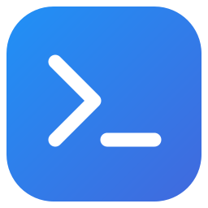
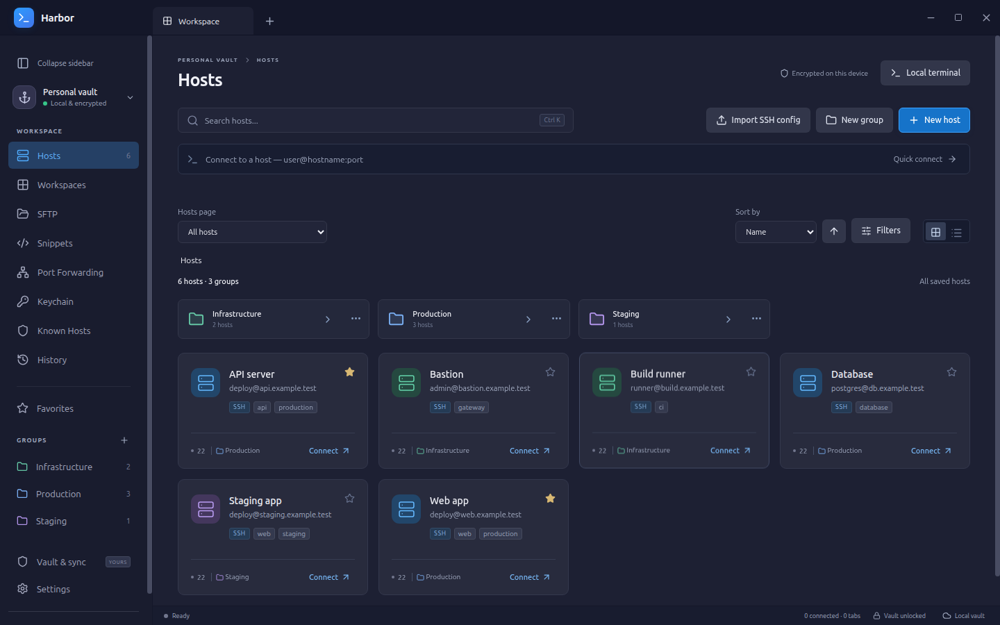

# Harbor



**An independent SSH workspace for your servers, with an encrypted vault and optional AI access that you control.**

Manage hosts, open terminals, transfer files and sync your encrypted vault through a folder of your choice. Harbor needs no Harbor account or subscription. Its optional local MCP service lets AI clients work on selected servers with permissions and approvals per client and host.

[Download releases](https://github.com/Jor-Tech/Harbor/releases) · [User guide](docs/user-guide.md) · [MCP guide](docs/mcp-agent-guide.md) · [PDF guide](docs/Harbor-MCP-guide-en.pdf)



*The workspace above uses fictional example hosts. No real server or account details are shown.*

> **Preview software:** Harbor is in alpha. Installers are not publisher-signed; macOS builds are ad-hoc signed and not notarized. Your operating system may warn or block installation. Keep a separate encrypted vault backup and review the release notes before upgrading. Do not disable system-wide protections to install a preview.

## Download and install

Open [GitHub Releases](https://github.com/Jor-Tech/Harbor/releases), select a release and download the package for your device. Preview releases are listed there alongside stable releases. Installers appear only after the complete release pipeline succeeds.

| Platform | Package |
| --- | --- |
| Windows x64 | `.exe` installer |
| macOS Apple Silicon | `mac-arm64.dmg` or `.zip` |
| macOS Intel | `mac-x64.dmg` or `.zip` |
| Linux x64 | `.deb` for Debian/Ubuntu, or `.AppImage` |

For Debian/Ubuntu, install the downloaded DEB with `sudo apt install ./Harbor-<version>-linux-amd64.deb`. On macOS, open the DMG and copy Harbor to Applications. On Windows, run the installer and choose the destination. See [platform installation notes](docs/desktop-previews.md) for details and current limitations.

The desktop app includes its runtime. **Node.js 24+ is needed only for local MCP clients, the experimental headless mode, or building from source.**

## First launch

1. **Create your vault.** Choose a password of at least 12 characters. Harbor cannot recover a forgotten vault password.
2. **Add a host.** In **Hosts → New host**, enter the server address, SSH port and username. Choose password authentication, a saved SSH key or an SSH agent such as 1Password.
3. **Connect.** Verify the server fingerprint before trusting a new server. Complete any password-manager or MFA prompts.
4. **Make a backup.** In **Vault & sync**, export an encrypted copy and keep it somewhere separate from this device. Local recovery copies do not protect against loss of the device.

Already using Harbor? Import your encrypted vault and enter its existing password. Updating the app normally preserves the existing vault and local settings; quit Harbor before replacing the app, then reopen it.

## What you can do

- **Manage servers:** hosts, nested groups, inherited connection settings, tags, favorites, search, sorting, SSH-config import and host duplication.
- **Work in terminals:** tabs, split panes, saved workspaces, search, command snippets, a local shell, opt-in reconnect per tab and optional per-host tmux session persistence.
- **Move and edit files:** two-panel SFTP, directory transfers, transfer progress, permissions and a remote text editor with concurrent-change detection.
- **Reach private networks:** jump hosts, local and remote forwarding, and a loopback SOCKS5 TCP proxy.
- **Use your SSH identity:** passwords, imported/generated keys, system/custom SSH agents and 1Password, with server verification and MFA.
- **Keep your vault portable:** encrypted export/import, folder sync, conflict review and recoverable local backups.
- **Connect AI clients:** optional local MCP access with explicit host rights and one-time, session or saved approvals.

See the [user guide](docs/user-guide.md) for everyday workflows. Headless operation remains experimental. Mobile clients, SSH certificates, Telnet/serial sessions and collaborative vaults are not implemented.

## Give an AI client controlled access

MCP is **off by default**. Enable it under **Settings → Local MCP access → Manage local MCP**, pair a local client, select its hosts and allowed actions, and copy its generated configuration. After saving permissions, choose **Resume MCP access** and reconnect the client.

There are two separate decisions: **what a client may request**, and **which requests may run automatically**. By default, allowed remote actions still need your approval.

- **Approve once:** permit the displayed request only.
- **Allow for this session:** reuse the permission during this MCP client connection; it expires on disconnect, pause, lock or exit.
- **Always allow / Automatic approvals:** save a permission for that client and host. File reads, folder listings and writes each support an exact path, a folder with its subfolders, or explicitly enabled any-path access.
- **Full Automatic Approval:** explicitly allow all six remote actions on one host for one client after reviewing the confirmation. It does not grant access to other hosts or override disabled actions.

**Shell commands have the SSH account's permissions.** File read/write scopes do not restrict what an approved shell command can do, and path rules do not sandbox remote symlinks. For tighter control, configure automatic file access only for the required folders and approve commands individually. Approved output can contain sensitive information and may reach the AI client's provider.

SSH fingerprint checks, password-manager approval and MFA remain separate. MCP clients cannot unlock the vault, export its credentials or change their own permissions.

For background use, **MCP management → Service → Keep Harbor in the system tray when closing the window** keeps the regular app available for requests. Vault-lock rules still apply.

Start with the [MCP setup and tool guide](docs/mcp-agent-guide.md), or share the [English PDF](docs/Harbor-MCP-guide-en.pdf). The [permission and security contract](docs/mcp.md) explains the exact boundaries.

## Check for updates

In **Settings → Releases & updates**:

- **Check now** checks public GitHub releases on demand.
- **Automatically check for updates** checks shortly after launch and every 12 hours while Harbor is running. It is off by default.
- **Include preview releases** controls whether alpha, beta and other prereleases are included. It starts enabled when running a preview.

A newer compatible release adds an **Update available** button to the titlebar. Open it to view the version and its download page. Downloads and installation are manual; Harbor never installs an update or restarts itself automatically.

Checks send no vault contents, saved hosts or credentials. GitHub receives the network request, including your public IP address. Preferences stay on this device. If release information is unavailable, Harbor shows an error rather than claiming you are up to date. **View releases & downloads** remains available in the browser.

## Your data and backups

The vault encrypts hosts, credentials, keys, snippets and other workspace data with AES-256-GCM. The password derives the encryption key using scrypt. No account backend or telemetry is built in. Local malware running with your user's access, or an administrator, is outside Harbor's protection boundary.

| Encrypted and shared with vault sync | Kept on this device |
| --- | --- |
| Hosts, groups, keys, snippets, saved workspaces and vault preferences | MCP pairings, permissions, approval rules and activity |
| Trusted SSH server identities and retained connection history | Sync-folder selection, automatic-sync choice, backup-retention settings and update-check preferences |

Vaults normally live in `~/.config/Harbor/` on Linux, `~/Library/Application Support/Harbor/` on macOS, or `%APPDATA%/Harbor/` on Windows. Manual lock, OS screen lock and suspend close SSH connections and pause MCP. Opt-in tmux sessions keep running remotely; saved workspaces retain their session references. **Lock when inactive → Never** disables only the inactivity timer.

Harbor keeps encrypted local recovery copies before vault changes. Use **Vault & sync → Manage backups** to review retention and protected copies, or **Recover backup** to restore one. Folder sync uses a folder managed by your chosen sync provider; Harbor does not provide cloud storage. Conflicting edits are preserved for review.

Read [backup and recovery](docs/vault-recovery.md), [vault protection and upgrades](docs/vault-protection.md), and [folder sync](docs/user-guide.md#folder-sync-across-devices) before relying on multi-device workflows.

## Build and contribute

Use Node.js 24 or newer:

```sh
npm ci
npm run build
npm start
```

For development, use `npm run dev`. For an unsigned package for the current OS, use `npm run dist:preview`; output goes to `preview/`.

```sh
npm test
npm run test:desktop
```

Tests use temporary vaults and disposable local SSH/SFTP servers. Desktop tests need a display; integration tests need permission to bind loopback ports. See [validation and device checks](docs/validation.md), [preview builds](docs/desktop-previews.md), and [release publishing](docs/desktop-releases.md). Automated builds do not replace hands-on installer, password-manager and suspend/resume checks.

For a bug report, include the Harbor version, OS and steps to reproduce. Remove credentials, vault files, pairing files, server details and sensitive output from reports and screenshots.

## License and independence

Harbor is released under the [MIT License](LICENSE). Dependencies and embedded fonts retain their own licenses; see [third-party notices](THIRD_PARTY_NOTICES.md).

Harbor is an independent project, not affiliated with Termius or 1Password. The installed Termius app was used as a visual and workflow reference; Harbor's application code and icons are independently authored. No Termius implementation, fonts, branding, account data or vault format is included.
